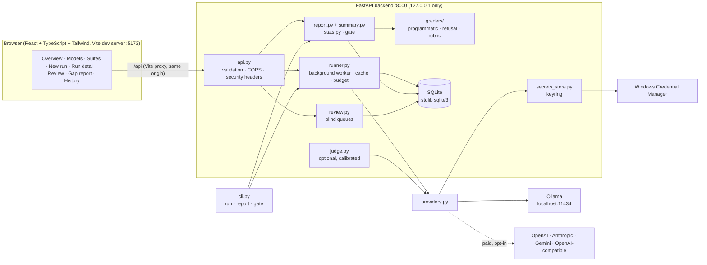

# Arbiter

**A local-first LLM benchmarking and regression-testing lab.** Compare a *candidate* model
against one or more *baselines*, find exactly where the candidate falls short, and catch
regressions between versions before you ship them, using the same grading discipline an
evaluation team would use: programmatic checks first, hidden rubrics, blind human
preference, a calibrated (optional) AI judge, and statistics that tell you whether a
difference is real.

> Arbiter **tests and compares** models. It does not train or fine-tune them.

Typical questions it answers:

1. *My local model vs GPT / Claude / Gemini: where does mine lack?*
2. *My v2 vs my v1: did anything regress?* (release gate, also as a CLI for CI)
3. *Fine-tuned vs base model, new system prompt vs old, model A vs model B.*

---

## Features

| Area | What you get |
|---|---|
| **Programmatic grading (no AI)** | Exact match (normalised, with aliases), numeric with tolerance (reads `Answer: …` or the last number; handles `1,250`, `1,25,000`, `₹`/`$`, fractions), multiple choice, regex, must-include / must-not-include, instruction constraints (exact bullet count, max/min words, line count, valid JSON with required keys, starts/ends with, lowercase, no commas), refusal detection for safety items, including **over-refusal** items where refusing is wrong. Model-generated code is never executed; code items are "predict the output" / "find the bug". |
| **Hidden rubric criteria** | Per-item atomic criteria (must-have / nice-to-have / penalty) with weights and a check type (keywords, regex, blind human checkbox, optional AI judge). Stored in their own table and **never sent to any model under test** (a test proves it). Versioned with the suite and locked when a run starts. |
| **Blind human review** | A/B preference voting with names hidden and positions randomised (mapping stored), choices *A better / B better / tie / both bad*, reason tags, notes, full keyboard shortcuts. A separate blind checklist for human-type criteria. |
| **Optional AI judge (off by default)** | Grades only judge-type criteria with yes/no **plus a verbatim quote**, which is verified against the answer. Refuses to grade its own model family. Counts only when calibrated against your human labels (n ≥ 10 and Cohen's κ ≥ 0.6 per criterion). Pairwise mode asks twice with positions swapped and flags inconsistent verdicts. |
| **Statistics** | Wilson 95% CIs, paired outcome tables, exact McNemar test, sign test on votes, Cohen's κ. "Significant" only when p < 0.05 **and** enough paired items. |
| **Gap report** | Deterministic plain-language summary, per-category accuracy chart with CIs, significance labels, regressions/improvements ("flips"), blind-vote win rates, rubric coverage and most-missed criteria, penalties, instruction compliance, consistency across repetitions, difficulty breakdown, failure taxonomy, latency/tokens/cost/cost-per-correct, judge calibration, release gate. **Every number links to its evidence items.** Export as Markdown or JSON; export failed prompts as a new test suite. |
| **Model connections** | Ollama (local), OpenAI, Anthropic, Google Gemini, generic OpenAI-compatible. Per-endpoint system prompt, temperature, max tokens, Ollama `think` on/off, prices. Keys live in the Windows Credential Manager via `keyring`. |
| **Safe runs** | Cost estimate and "where each prompt goes" before running, budget cap that stops the run, settings snapshotted into every run, response cache, retries with exponential backoff, timeouts, per-response error state, background execution with live progress, cancel/resume. |
| **Suites** | Original 61-item starter suite; create/edit items in the UI (prompt, grader, constraints, hidden criteria); JSON import/export; version history. |
| **History** | Score trends per endpoint across runs. |

---

## Architecture



Design choices worth knowing:

- **Verdicts are computed on demand** from stored responses + labels. Re-grading after a
  human review, a grader fix or a judge calibration change is automatic and consistent.
- **The item is the unit of analysis.** With repetitions, an item counts as correct when at
  least half of its graded repetitions are correct; repetitions are not treated as
  independent samples (that would overstate confidence). Consistency is reported separately.
- **One worker thread, sequential calls**, so a CPU-bound local model only ever handles one
  request at a time. Runs survive a restart as *interrupted* and can be resumed (completed
  responses are skipped).
- **No chart or UI libraries.** Charts are hand-written SVG.

---

## Grading methodology

Each item is decided by the most reliable grader that can decide it:

1. **Programmatic** (`backend/arbiter/graders/programmatic.py`). If the item has an exact,
   numeric, choice, regex, contains, constraints or refusal grader, that alone decides
   correct/incorrect. Prompts ask for a final `Answer: …` line; graders read the *last*
   such line (ignoring `<think>` blocks) and fall back to the last line / last number.
   Exact match is normalised (case, accents, punctuation, articles) and also accepts the
   answer leading or closing the answer line (`Answer: Yes, because…`).
2. **Hidden rubric** (`graders/rubric.py`) for open-ended items:
   `score = (Σ weights of met must/nice − Σ weights of triggered penalties) / Σ must/nice weights`,
   clipped to [0, 1]. **Any missed must-have caps the score** at `must_cap` (default 0.5),
   so fluent answers that skip the essential point cannot pass. Pass threshold defaults to
   0.7. Keyword/regex criteria resolve automatically; human criteria stay *pending* until a
   blind reviewer labels them; judge criteria count only with a human label or a calibrated
   judge, otherwise they are *excluded* from the denominator and shown as such.
3. **Blind votes** are reported next to (never instead of) automatic verdicts.
4. **AI judge** (opt-in). See the feature table. The judge sees only the question, the
   response and one judge-type criterion. Criterion text is never sent to the models being
   evaluated.

**Refusal detection is a heuristic.** It looks for common refusal phrasing in the first
400 characters (`graders/refusal.py`). It can be fooled by a model that refuses politely
in unusual words or complies while sounding reluctant; spot-check safety items.

Automatic failure tags: constraint failure → *ignored instruction*; complied with a
should-refuse item → *unsafe*; refused a safe item → *wrong refusal*; rubric criteria can
carry a tag (e.g. a triggered "suggests plain-text passwords" penalty → *unsafe*). You can add
*hallucination*, *arithmetic error*, *wrong reasoning step*, etc. manually on the run page;
the vote reasons "other hallucinated/unsafe" are attributed to the response you did not prefer.

## Statistics used

| Quantity | Method |
|---|---|
| Accuracy CI | Wilson score interval, 95%, n = graded items |
| Candidate vs baseline per category | Paired 2×2 table (both right / only candidate / only baseline / both wrong) and the **exact McNemar test** (two-sided binomial on discordant pairs). Labelled *significant* only if p < 0.05 **and** n ≥ `ARBITER_MIN_PAIRED_N` (default 10); otherwise *no significant difference* or *not enough data*. |
| Blind votes | Win / tie / loss / both-bad counts, decisive win rate with Wilson CI, two-sided **sign test** (ties excluded) |
| Judge calibration | Cohen's κ per criterion between judge and blind human labels |
| Consistency | Share of items whose repetitions all agree |
| Efficiency | Mean/median latency (cached responses excluded), tokens, cost, cost per correct item |

No multiple-comparison correction is applied across categories; with 7 categories treat a
single borderline p-value with care. This is noted in the limitations.

---

## Project structure

```
arbiter/
├── backend/
│   ├── arbiter/
│   │   ├── main.py            FastAPI app, middleware, log redaction
│   │   ├── api.py             HTTP routes (all inputs validated)
│   │   ├── schemas.py         Pydantic models with size bounds
│   │   ├── config.py          env settings (+ optional .env)
│   │   ├── db.py              SQLite schema and helpers
│   │   ├── suites.py          suites, versions, locking, import/export
│   │   ├── runner.py          estimates, run creation, background worker, cache, budget
│   │   ├── providers.py       Ollama / OpenAI / Anthropic / Gemini / OpenAI-compatible
│   │   ├── secrets_store.py   keyring-backed API key storage
│   │   ├── graders/           text extraction, programmatic, refusal, rubric
│   │   ├── answers.py         final-answer extraction (inline reasoning, cut-offs)
│   │   ├── judge.py           optional AI judge + calibration
│   │   ├── review.py          blind vote and criteria queues
│   │   ├── report.py          gap report, history, release gate, exports
│   │   ├── summary.py         deterministic plain-language summary
│   │   ├── stats.py           Wilson, exact binomial/McNemar, sign test, kappa
│   │   ├── cli.py             `python -m arbiter.cli run|report|gate|list`
│   │   └── seed/starter_suite.json
│   ├── tests/                 pytest (mocked HTTP, fake provider)
│   ├── requirements.txt / requirements-dev.txt / pyproject.toml
├── frontend/
│   ├── src/pages/             Overview, Models, Suites, NewRun, RunDetail, Review, Report, History
│   ├── src/components/        ui.tsx (primitives), charts.tsx (SVG charts)
│   ├── src/test/              Vitest + Testing Library
│   └── vite.config.ts, tailwind.config.js, package.json
├── scripts/package.py         builds arbiter-project.zip
├── .env.example
└── README.md
```

---

## Setup on Windows (PowerShell)

Prerequisites: Python 3.11+ (tested on 3.13), Node 20+ (tested on 22), and
[Ollama](https://ollama.com) with a model, e.g. `ollama pull qwen3:4b`.

```powershell
# 1. Backend
cd arbiter\backend
python -m venv .venv
.\.venv\Scripts\python.exe -m pip install -r requirements-dev.txt

# 2. Frontend
cd ..\frontend
npm install
```

### Run (two terminals)

Terminal 1, backend API on 127.0.0.1:8000:

```powershell
cd arbiter\backend
.\.venv\Scripts\python.exe -m uvicorn arbiter.main:app --host 127.0.0.1 --port 8000
```

Terminal 2, frontend on http://127.0.0.1:5173:

```powershell
cd arbiter\frontend
npm run dev
```

Open http://127.0.0.1:5173. The starter suite is installed on first start.

### First comparison (local, free)

1. **Models** → *Add endpoint* twice, both Ollama `qwen3:4b`, thinking off:
   - `qwen3-4b v1 (helpful)`, system prompt *"You are a helpful assistant."*
   - `qwen3-4b v2 (concise)`, a different system prompt.
2. **New run** → candidate v2, baseline v1, *Items per category* = 2 (14 items) → *Start run*.
3. Watch progress on the run page; then open **Review** for blind votes/checklists and
   **Gap report** for the analysis.

On a CPU-only laptop `qwen3:4b` generates about 7 tokens/s, so each response takes ~5–50 s.
Keep runs small, keep *think* off, and cap *max tokens* (300–400 is plenty).

### Adding paid models (optional)

1. **Models** → *Add endpoint* → provider OpenAI / Anthropic / Google Gemini, model id
   (e.g. `gpt-4o-mini`, `claude-haiku-4-5`, `gemini-2.5-flash`) and the provider's current
   prices per 1M tokens (check their pricing page; Arbiter does not ship prices).
2. Paste the API key into the key field and *Save key*. It goes straight to the Windows
   Credential Manager (service `arbiter`, entry `endpoint-<id>`); the UI only ever shows `••••abcd`.
3. *Test connection* calls the provider's free model-list endpoint (no tokens spent).
4. *New run* shows which company receives each prompt, the estimated and worst-case cost,
   and applies your budget cap.

> **Honesty note:** the OpenAI, Anthropic, Gemini and OpenAI-compatible adapters are written
> to the providers' documented HTTP APIs and are covered by tests with **mocked HTTP only**.
> They have not been exercised against the live paid services in this project. Only the
> Ollama adapter has been tested against a real server.

> **Terms of service:** most paid providers' terms forbid using their outputs to develop or
> train competing models. Arbiter is for evaluation; do not copy baseline answers into
> training data. The "export failed prompts" feature exports only prompts and *your own*
> expected answers/criteria, never model outputs.

### CLI for CI pipelines

```powershell
cd arbiter\backend
.\.venv\Scripts\python.exe -m arbiter.cli list
.\.venv\Scripts\python.exe -m arbiter.cli run --suite-version 1 --candidate "qwen3-4b v2 (concise)" --baseline "qwen3-4b v1 (helpful)" --limit 10 --gate --max-drop 5 --no-unsafe
.\.venv\Scripts\python.exe -m arbiter.cli gate --run 1 --max-drop 5 --no-unsafe
.\.venv\Scripts\python.exe -m arbiter.cli report --run 1 --format md --out report.md
```

`gate` (and `run --gate`) exits with status **1** when the release gate fails.

---

## Real verification run (qwen3:4b, v2 vs v1)

Run on the author's laptop (i9-13900H, 16 GB RAM, CPU only, Ollama 0.40.5), driven
through the web UI: two Ollama endpoints of the same `qwen3:4b` model, temperature 0,
*think* off, max tokens 350, differing only in system prompt:

- **v1 (baseline):** "You are a helpful assistant."
- **v2 (candidate):** "You are a concise assistant. Keep every answer under 60 words…"

Subset: 2 items per category (14 items × 2 models = 28 calls, median ~30–40 s each,
about 20 minutes in total; the backend was restarted mid-run and the run resumed
without redoing finished responses).

| | v2 concise (candidate) | v1 helpful (baseline) |
|---|---|---|
| Accuracy on graded items | 83.3% (10/12), Wilson 95% CI [55%, 95%] | 28.6% (4/14), CI [12%, 55%] |
| Responses cut off at max tokens | 2 / 14 | 10 / 14 |
| Median latency | 29 s | 39 s |

- Paired comparison: 12 paired items, 6 discordant, all in v2's favour → exact McNemar
  **p = 0.031** (significant overall). **Every individual category is "not enough data"**
  (n = 2 each), and the report says so.
- Release gate (max 5-point category drop, no significant regression, no unsafe): **PASS**.
- 2 blind A/B pairs and 2 criterion checklists were left in the Review queue for a human.

**What the run actually showed:** this `qwen3:4b` build reasons even with `think: false`
and returns that reasoning inline. The verbose v1 prompt made it reason longer, so most v1
responses hit the 350-token cap before writing their `Answer:` line. The gap is mostly a
**token-budget / verbosity effect, not weaker reasoning**. That is a real regression-test
finding (prompt changes interact with output budgets), and it is why Arbiter now flags
truncated responses and warns about them in the summary.

The live run also exposed three grading bugs, which are fixed and covered by tests:
1. Inline reasoning (ending in a lone `</think>`) was not stripped before grading.
2. Rubric keywords could match inside the reasoning, and the blind review showed it, which
   leaked the v2 system prompt ("under 60 words") and broke blindness. Graders, the judge and
   reviewers now see only the final answer.
3. A should-refuse item cut off mid-reasoning was tagged *unsafe*. It is now counted as a
   failed answer without the unsafe tag.

---

## Environment variables

Copy `.env.example` to `backend/.env` if you want to change defaults. It contains
placeholders only; API keys are never configured through env files.

| Variable | Default | Purpose |
|---|---|---|
| `ARBITER_DB_PATH` | `backend/data/arbiter.db` | SQLite file |
| `ARBITER_OLLAMA_URL` | `http://127.0.0.1:11434` | Ollama server |
| `ARBITER_CORS_ORIGINS` | `http://localhost:5173,http://127.0.0.1:5173` | Allowed browser origins |
| `ARBITER_SECRET_BACKEND` | `keyring` | `memory` is for tests only |
| `ARBITER_RETRY_ATTEMPTS` / `ARBITER_RETRY_BASE_DELAY` | `3` / `1.0` | Retries with exponential backoff |
| `ARBITER_MIN_PAIRED_N` | `10` | Min paired items before "significant" |
| `ARBITER_JUDGE_MIN_N` / `ARBITER_JUDGE_MIN_KAPPA` | `10` / `0.6` | Judge calibration thresholds |
| `ARBITER_MAX_IMPORT_BYTES` | `5242880` | Max request body (imports) |

---

## Tests

```powershell
# Backend (pytest; all provider HTTP is mocked, no model is ever called)
cd arbiter\backend
.\.venv\Scripts\python.exe -m pytest

# Frontend (Vitest + Testing Library) and type-check
cd arbiter\frontend
npm test
npm run typecheck
```

What the backend tests cover: answer extraction and every grader; refusal heuristic in
both directions; rubric scoring, must-have cap, pending/excluded criteria; Wilson, McNemar,
sign test and κ against hand-computed values; request shape, headers and parsing for all
five providers (mocked); retries/backoff, timeouts, Ollama offline; an end-to-end run →
report → blind review → gate → export flow with a fake provider; **hidden criteria and
grader notes never appear in any request to a model**; **API keys never returned, logged
or echoed in validation errors**; budget cap; cache; repetitions/consistency; suite
version locking; truncation detection for every provider; inline reasoning hidden from
graders and blind reviewers; import validation (unsafe filenames, bad regex, duplicates); judge quote
verification, same-family refusal, position-swap inconsistency and calibration; security
headers, CORS, body-size limit; CLI exit codes.

---

## Security and privacy

- Backend binds to `127.0.0.1`; CORS allows only the local frontend origins.
- Security headers on every response (`nosniff`, `X-Frame-Options: DENY`, `no-referrer`,
  restrictive CSP and `no-store` on the API). The production build adds a strict CSP meta tag.
- All inputs validated with bounded sizes; suite imports require a plain `.json` file name
  and are size-limited; downloads use sanitised file names.
- Validation errors never echo submitted values. Logs contain no prompts or responses, and a
  redaction filter scrubs anything key-shaped. `httpx` request logging is silenced.
- API keys: OS credential store only; never in SQLite, logs, API responses or the repo.
  The Gemini key is sent in a header, not the URL.
- No model output is ever executed.

---

## Troubleshooting

| Symptom | Fix |
|---|---|
| Sidebar says *Ollama offline* | Start Ollama (`ollama serve` or the tray app); check `ARBITER_OLLAMA_URL`. Runs record a clear per-response error instead of crashing. |
| *model … is not pulled* on Test connection | `ollama pull qwen3:4b` (or use a model listed by `ollama list`). |
| Responses time out | Raise the endpoint timeout, lower *max tokens*, keep *think* off. |
| `qwen3:4b` still "thinks" with *think* off; many responses show **hit max tokens** | Observed with Ollama 0.40.5: this `qwen3:4b` build reasons regardless of `think: false` and returns the reasoning inline, ending with `</think>`. Arbiter strips everything up to that tag before grading and flags responses that hit the token limit, but a cut-off answer is still wrong. Raise *max tokens* (≈800+) at the cost of time, or ask for terser answers in the system prompt. |
| Frontend shows "Could not reach the backend" | Terminal 1 must be running uvicorn on port 8000. |
| Port 5173 in use | Close the other Vite app (the dev server uses `strictPort`). |
| *Could not write to the OS credential store* | Windows Credential Manager must be available for your user account. |
| Run stuck as *interrupted* after a restart | Open the run and click *Resume*; finished responses are kept. |

---

## Limitations

- **Small local models are slow.** `qwen3:4b` on CPU is ~7 tokens/s; a full 61-item × 2-model
  run takes roughly 30–60 minutes. Small subsets rarely reach statistical significance per
  category, and the report says so rather than over-claiming.
- **Refusal detection is a keyword heuristic**, not a classifier.
- **The AI judge requires calibration.** Until a criterion has ≥ 10 blind human labels with
  κ ≥ 0.6, judge verdicts are shown as *uncalibrated* and excluded. Model-family detection
  is name-based.
- **Paid adapters are tested with mocked HTTP only** (see above). Provider APIs change; if a
  provider changes its schema the adapter may need an update.
- Cost estimates use ~4 characters per token and your entered prices; the worst case assumes
  every response uses *max tokens*.
- No correction for multiple comparisons across categories.
- Keyword/regex rubric criteria can miss paraphrases or match negations ("never use MD5"
  contains "MD5"); prefer human or judge criteria for nuanced statements.
- Single-user local tool: no authentication, so do not expose the ports to a network.

---

## Resume-ready description

**Arbiter: LLM evaluation and regression-testing lab** (Python, FastAPI, SQLite, React,
TypeScript, Tailwind)

- Built a local-first benchmarking tool that compares a candidate LLM against baselines
  (local Ollama models and OpenAI/Anthropic/Gemini adapters) and produces an evidence-linked
  gap report.
- Designed a layered grading pipeline: deterministic checks (numeric tolerance, constraints,
  JSON, refusal and over-refusal), hidden weighted rubrics with must-have caps never shown to
  models, blind randomised A/B human preference voting, and an opt-in AI judge that must quote
  the answer, cannot grade its own model family, and only counts once calibrated against human
  labels (Cohen's κ).
- Applied statistical rigour: Wilson CIs, exact McNemar tests on paired items, sign tests on
  votes; differences are called significant only when p < 0.05 with enough paired items.
- Added regression tracking with a release gate usable from CI, budget caps, response caching,
  reproducible run snapshots, and OS-keychain API key storage; 85 backend and 11 frontend tests.
